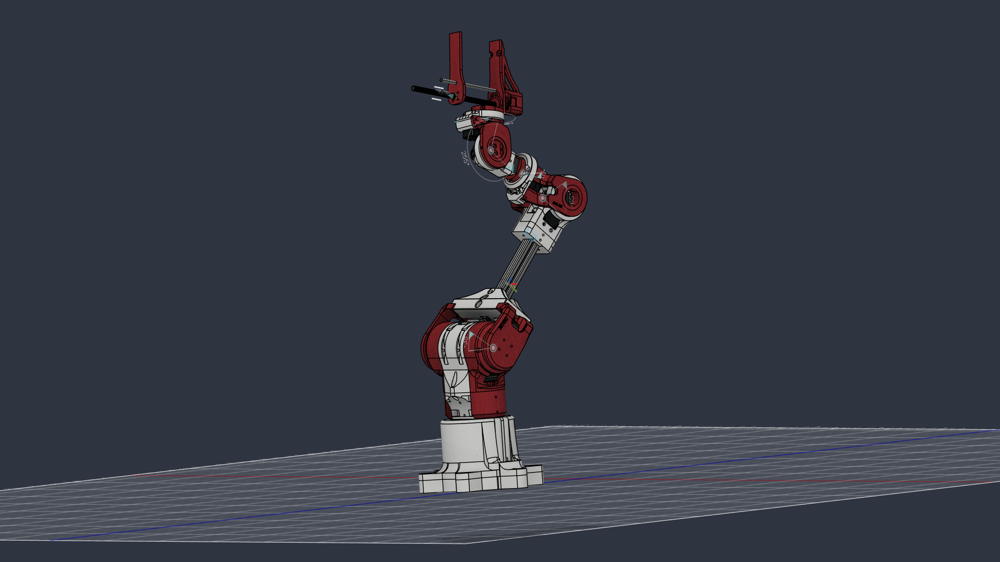

# arrm_ws — 6-DOF robotic arm on ROS 2

A 6-DOF articulated arm with a single-finger gripper, running ROS 2 Jazzy and
MoveIt 2 on real hardware. Plans a collision-free path and moves to a goal pose
in joint space or Cartesian space.

<!-- Photos of the built arm go in docs/images/ and can be shown here:

-->



## Hardware

| Joint | Role | Actuator | Board | Feedback |
|---|---|---|---|---|
| `joint1` | base / waist | DS51150 #1 | Arduino Mega 2560, PWM D9 | pot → ADS1115 `0x4A` |
| `joint2` | shoulder | DS51150 #2 | Mega 2560, PWM D10 | pot → ADS1115 `0x48` |
| `joint3` | elbow | DS51150 #3 | Mega 2560, PWM D11 | pot → ADS1115 `0x49` |
| `joint4` | wrist roll | ST3215 id 1 | Waveshare ESP32 servo driver | internal encoder |
| `joint5` | wrist pitch | ST3215 id 2 | Waveshare ESP32 | internal encoder |
| `joint6` | tool roll | ST3215 id 3 | Waveshare ESP32 | internal encoder |
| `Slider_39` | gripper finger | N20 + lead screw | DRV8871 (planned) | INA219 current (planned) |

The three DS51150 hobby servos have no position feedback of their own, so each
one's potentiometer is tapped and the Mega closes a 200 Hz loop around it. The
three ST3215 serial-bus servos close their own loops internally. Both boards are
safe at boot, checksum their commands, stream a binary status frame and relax on
a 400 ms dead-man.

Links are 3D-printed. Power is a 3S LiPo. **The physical e-stop is the only
thing that removes power** — every software protection relaxes the servos, which
means the arm goes limp and falls.

## Quick start

```bash
colcon build --symlink-install
source install/setup.bash
```

Mock hardware — no serial ports, no firmware, nothing can be damaged. Use this
for all planner work:

```bash
ros2 launch arm_moveit_config demo.launch.py
```

Real hardware:

```bash
ros2 launch arm_moveit_config demo.launch.py use_mock_hardware:=false
# or, detached and logged:
tools/start_stack.sh
tools/stop_stack.sh
```

In RViz, use the **MotionPlanning** panel with planning group `arm`: drag the
orange marker to a goal, then Plan, then Execute.

From the command line:

```bash
ros2 run arm_demos move_to --named ready
ros2 run arm_demos move_to --pose 0.25 0.0 0.25        # tool0, approaching down
ros2 run arm_demos move_to --joints 0.2 -0.6 1.9 1.4 -0.7 0
ros2 run arm_demos cartesian_to --relative 0 0 -0.08   # straight line down
```

Tests:

```bash
colcon test && colcon test-result --all
```

## Layout

| Path | What |
|---|---|
| `src/arm_description/` | URDF/xacro, meshes, joint limits, `ros2_control` description |
| `src/arm_hardware/` | The `ros2_control` hardware interface for both boards |
| `src/arm_moveit_config/` | SRDF, kinematics, planners, collision matrix, RViz |
| `src/arm_demos/` | `move_to` and `cartesian_to` command-line planners |
| `firmware/esp32_st3215/` | ESP32 wrist firmware (PlatformIO) |
| `firmware/esp32_stock_backup/` | Full-chip backup of the board's stock firmware |
| `tools/` | Bench and bring-up scripts that talk to the boards without ROS |
| `docs/PROJECT.md` | The project record: what was found wrong, and how it was fixed |

**Joint limits live in exactly one file:**
`src/arm_description/config/joint_parameters.yaml`. The xacro reads it and
`arm_moveit_config/config/joint_limits.yaml` mirrors it for MoveIt; a test fails
the build if the two drift apart. Never edit a limit anywhere else.

The wiring and sign conventions live in
`src/arm_description/config/actuators.yaml`. A reversed joint is fixed there, never
by flipping an axis in the URDF.

## Status

Working: joint-space and Cartesian planning and execution on hardware, 6/6
joints within about 1 degree, IK 100% solved on a 60-pose benchmark (median
4 ms), self-collision matrix generated from the real convex-hull geometry.

Not done yet:

- **The gripper is not built.** `Slider_39` exists in the model and a
  `gripper_controller` is declared, but it runs in loopback.
- No camera, so no octomap and no vision-guided grasping.
- `effort` values are provisional, so payload capability is unknown.
- Joints 1–3 have no torque or current sensing, so force control and compliance
  are not possible without changing actuators.

Known issues and the measurements still outstanding are listed in
[`docs/PROJECT.md`](docs/PROJECT.md) under *Open questions*.

## Safety

- Keep the e-stop within reach whenever the arm is powered.
- Every software protection ends in the servos relaxing. A relaxed arm falls.
- `tools/motor_test.py estop` stops the boards from any terminal.
- Shut the stack down with `tools/stop_stack.sh`, not by killing it: the boards
  need `on_deactivate` to run, or they latch a dead-man fault.
- Never open a board's serial port while the stack is running — two readers
  split the bytes and the hardware interface loses its status frames.

## Requirements

ROS 2 Jazzy on Ubuntu 24.04, `ros-jazzy-moveit`, `ros-jazzy-ros2-control` and
`ros-jazzy-ros2-controllers`. The firmware builds with PlatformIO. Serial access
needs membership of `dialout`:

```bash
sudo usermod -aG dialout "$USER"   # then log out and back in
```

## Author

Abhinav
