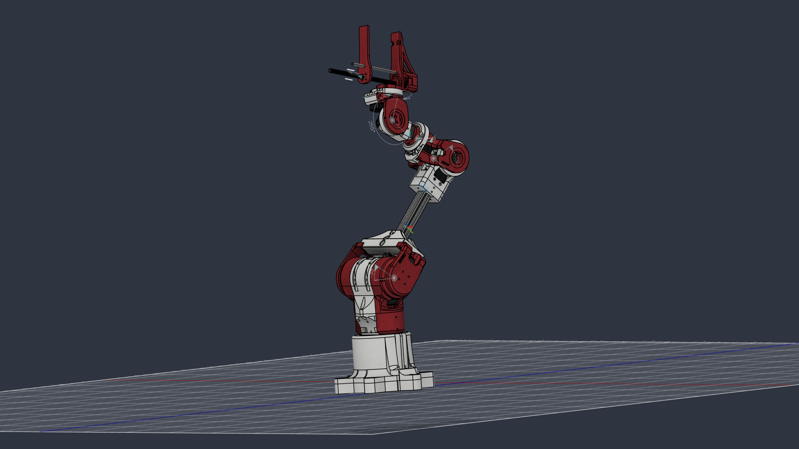

# arm_description

URDF/xacro, meshes and `ros2_control` configuration for the 6-DOF arm.



Derived from a Fusion 360 export, which is kept untouched outside this
repository as the export of record; **every change from it is listed, with the
reason, in [CAD_PROVENANCE.md](CAD_PROVENANCE.md)**. Project status, the problems
found and the open measurements are in [`docs/PROJECT.md`](../../docs/PROJECT.md).

## Use

```bash
ros2 launch arm_description display.launch.py      # model + one slider per joint
colcon test --packages-select arm_description      # regression tests
```

Expand the model standalone:

```bash
xacro urdf/arm.urdf.xacro use_mock_hardware:=true > /tmp/arm.urdf && check_urdf /tmp/arm.urdf
```

## Where things live

| Path | What |
|---|---|
| `urdf/arm.urdf.xacro` | Entry point. `world` frame, base mount, `joint6`, gripper slider, `tool0` |
| `urdf/assemblies/arm_links.urdf.xacro` | Links and `joint1`–`joint5` |
| `urdf/arm.ros2_control.xacro` | One hardware component, all 7 joints; `use_mock_hardware` switches mock/real |
| `config/joint_parameters.yaml` | **The single source of truth** for limits, base mount and joint zero offsets |
| `config/ros2_controllers.yaml` | `joint_state_broadcaster`, `arm_controller`, `gripper_controller` |
| `meshes/*/*_convex.stl` | Collision geometry — convex hulls of the visual meshes |
| `urdf/arm_final.urdf` | The exporter's flat URDF, kept as the audit reference |

## xacro arguments

| Argument | Default | |
|---|---|---|
| `use_mock_hardware` | `true` | `false` loads `arm_hardware/ArmSystemHardware`, driving the real boards |
| `mega_port` | `/dev/ttyACM0` | DS51150 joints 1–3. Prefer the `/dev/serial/by-id/` path |
| `esp32_port` | `/dev/ttyUSB0` | ST3215 joints 4–6 |
| `use_fake_gripper` | `true` | keep the gripper on loopback while the arm is real |
| `prefix` | `""` | link/joint name prefix |

## Tools

| Command | What it does |
|---|---|
| `ros2 run arm_description capture_zero.py [--apply]` | Make the pose set with the sliders the new joint zero |
| `ros2 run arm_description make_collision_meshes.py [--audit]` | Audit collision geometry against the visuals; regenerate failures as convex hulls |

After changing a mesh, a limit or a zero, regenerate the self-collision matrix:
`ros2 run arm_moveit_config analyse_self_collision.py`.

## Conventions

`world` z-up, base on z=0, waist axis on the world Z axis, arm reaches along +X.
At all joints = 0 the arm stands upright. `tool0`: +Z approach, +Y finger travel.
SI units throughout.
